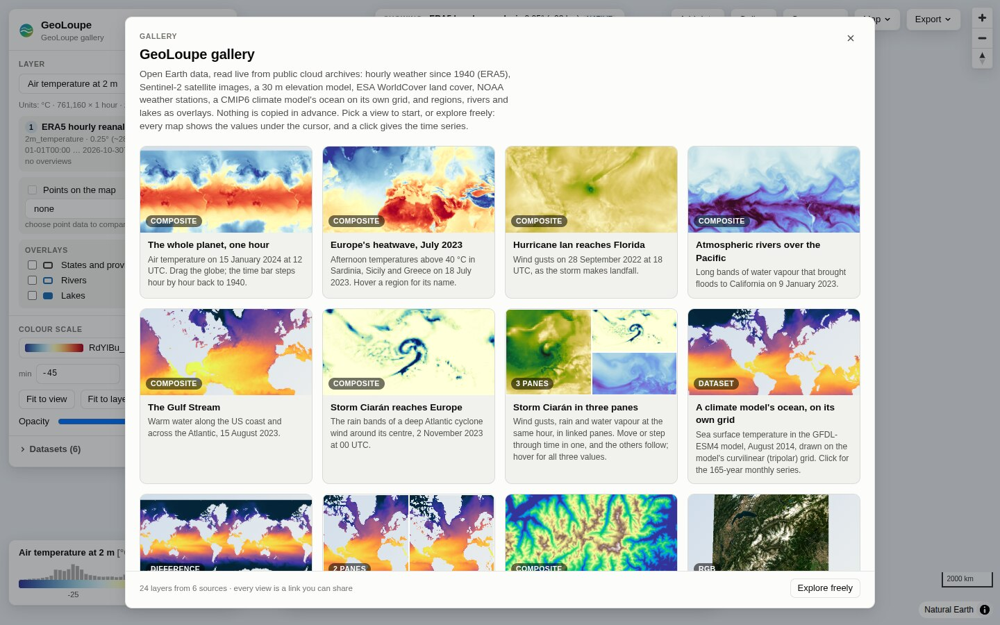
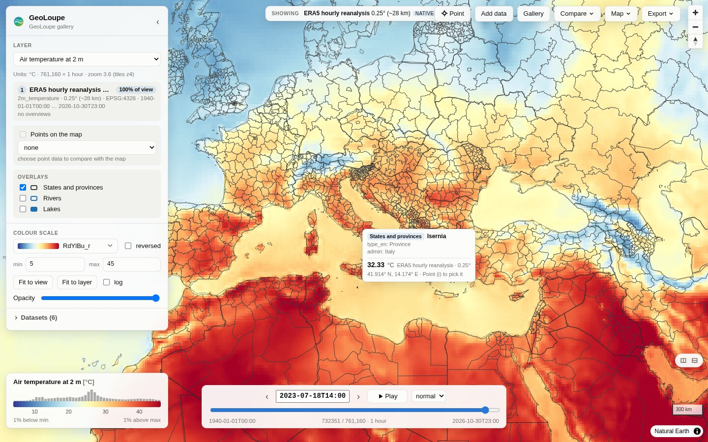
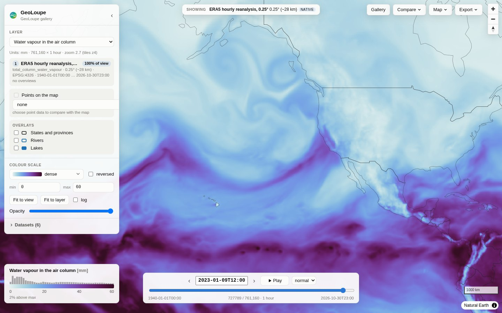
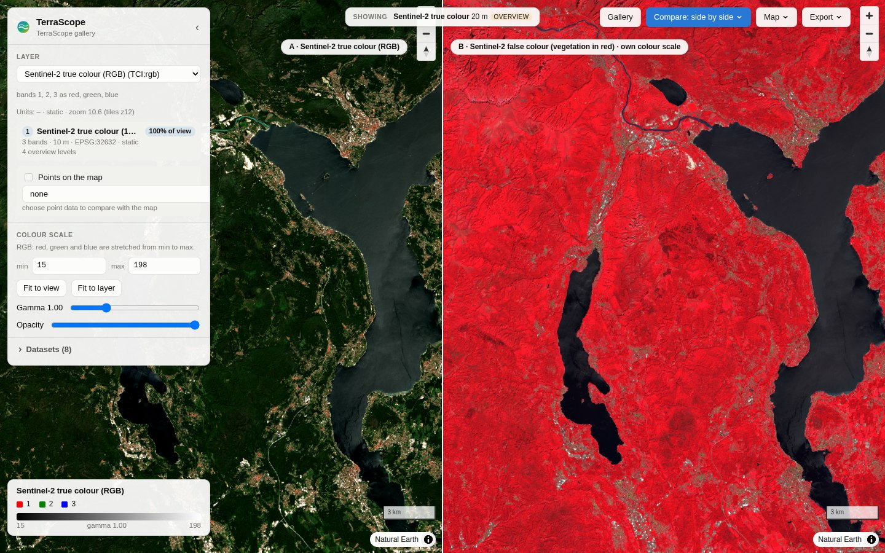
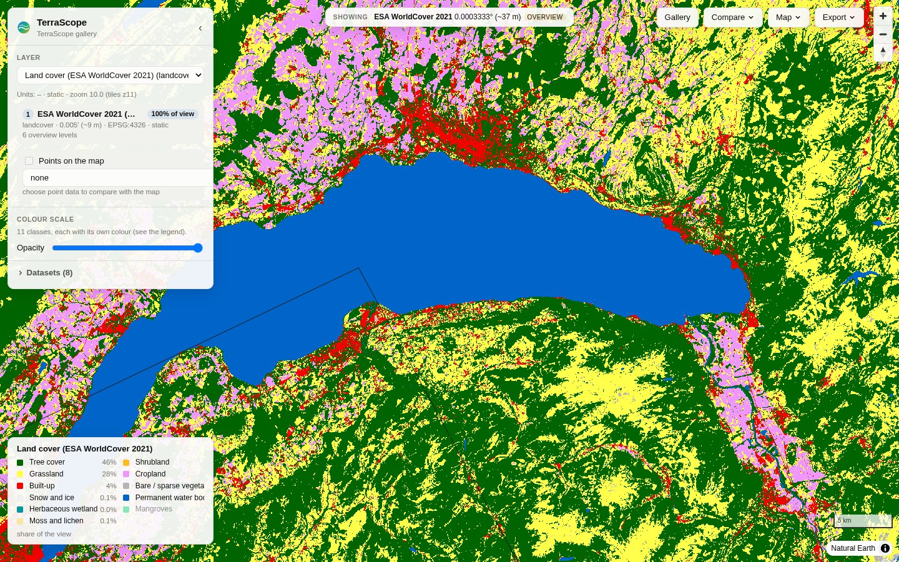
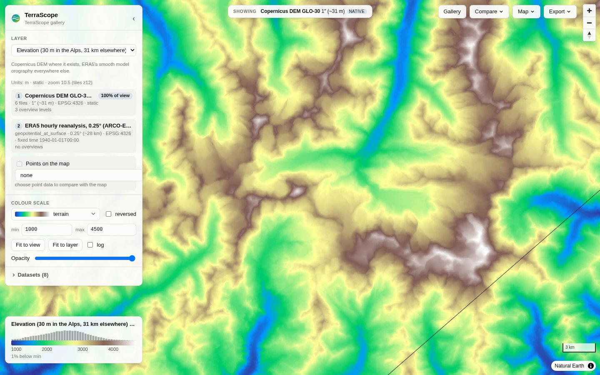
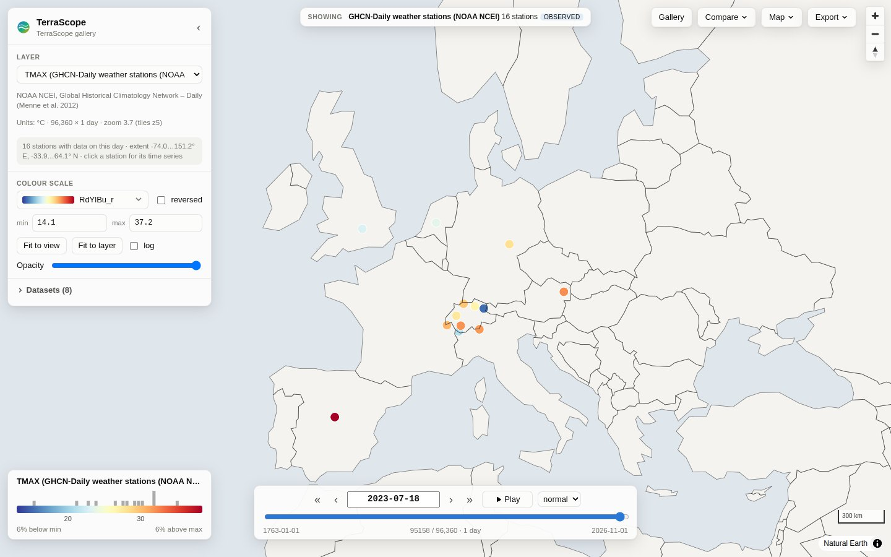

# TerraScope

**Explore large scientific and geospatial datasets on an interactive map: from the whole planet down
to 10 m, through time, with the values one click away.**

TerraScope puts gridded data on a web map: weather and climate reanalyses, model output, satellite
images, elevation models, land cover, and station records. It reads them where they are (Zarr,
NetCDF, GRIB, GeoTIFF/COG, CSV, Parquet; local or in public cloud buckets) and reads only what the
screen can show. Datasets of different resolution become one seamless layer: zoomed out, you see the
coarse global field; zoom in, and the fine data takes over where it exists.



## Try it: the gallery of open data

```bash
git clone <this repository> terrascope && cd terrascope
uv sync                          # or: pip install -e .
uv run terrascope gallery        # → http://localhost:8000
```

The gallery needs an internet connection and nothing else: no download in advance, no account, no
key. The server starts in 10–30 s (it reads the remote metadata), and a map tile takes 0.3–1.5 s over
the internet.

| Data | Source | What you can do |
|---|---|---|
| ERA5 hourly reanalysis, 0.25°, 1940 → last week (temperature, rain, water vapour, wind gusts, sea temperature) | [ARCO-ERA5](https://github.com/google-research/arco-era5) Zarr on Google Cloud, 761 160 hourly steps | step hour by hour, play, compare two dates, time series of any point |
| Copernicus DEM GLO-30 (30 m), six 1° tiles in the Western Alps, over ERA5's 31 km orography | [Copernicus DEM](https://registry.opendata.aws/copernicus-dem/) COGs on AWS | zoom from 31 km to 30 m in one layer |
| Sentinel-2 L2A, 10 m: the 10 least cloudy scenes of August 2023 over the Western Alps | a STAC search of [Earth Search](https://element84.com/earth-search/) (Element84), COGs on AWS | one seamless mosaic in true colour, false colour (near infrared) or single bands, side by side |
| ESA WorldCover 2021, 10 m, 45–48° N, 6–9° E | [ESA WorldCover](https://registry.opendata.aws/esa-worldcover-vito/) COG on AWS | 11 land-cover classes with names, colours and shares of the view |
| GFDL-ESM4 climate model ocean (CMIP6 historical), monthly 1850–2014, on its native tripolar grid | [Pangeo CMIP6](https://pangeo-data.github.io/pangeo-cmip6-cloud/) Zarr on Google Cloud | a curvilinear model grid drawn as it is; difference of two months 165 years apart |
| States and provinces, rivers, lakes (overlays) | [Natural Earth](https://www.naturalearthdata.com/) 1:10m GeoJSON | switch on in the layer panel; hover a region for its name next to the data value |
| GHCN-Daily stations, 21 long records (Milan since 1763) | [NOAA NCEI](https://www.ncei.noaa.gov/products/land-based-station/global-historical-climatology-network-daily) CSV files | daily max/min temperature and precipitation; click a station for its whole record |

The gallery is a normal configuration file: `terrascope gallery --show-config` prints it, so you can
copy it and change it.

## Your own data

No configuration is needed for a first look:

```bash
uv run terrascope serve /path/to/data.zarr        # or .nc, .grib2, .tif, a URL
uv run terrascope serve grid.zarr stations.csv     # several files; tables become point layers
uv run terrascope serve grid.zarr regions.geojson  # vector files become overlays
uv run terrascope serve s3://copernicus-dem-30m/Copernicus_DSM_COG_10_N46_00_E007_00_DEM/Copernicus_DSM_COG_10_N46_00_E007_00_DEM.tif  # public S3: no setup
uv run terrascope serve config.yaml --allow-open --open-root ~/data   # "Add data" in the browser
uv run terrascope info  /path/to/data.zarr        # what TerraScope sees: variables, grid, CRS, times
```

To combine datasets into one layer, add colour scales, or list featured views, write a small YAML
file ([full reference](docs/configuration.md), more in [examples/](examples/)):

```yaml
title: Elevation
datasets:
  dem:    {mosaic: [N45E006.tif, N45E007.tif, N46E006.tif, N46E007.tif], variable_name: elevation}
  global: {path: https://example.org/global-dem-1km.tif, variable_name: elevation}
layers:
  elevation:
    title: Elevation (30 m where available)
    sources:                      # the finest data wins; coarser data fills the rest
      - {dataset: dem, variable: elevation}
      - {dataset: global, variable: elevation}
views:                            # optional: the gallery start screen
  - {title: The Matterhorn, layer: elevation, center: [7.66, 45.98], zoom: 11}
```

**On a remote machine or HPC node:** run `terrascope serve config.yaml --port 8000` there and tunnel:
`ssh -N -L 8000:localhost:8000 <host>`. Behind JupyterHub with jupyter-server-proxy, open
`…/user/<name>/proxy/8000/` (all URLs are relative).

**In a notebook:**

```python
import xarray as xr, terrascope
ds = xr.open_zarr("data.zarr")
terrascope.show({"data": ds})           # interactive map in the cell output
```

## Features

* **Seamless multi-resolution layers.** Stack sources (a 30 m DEM over a 31 km one, a regional model
  over a global one, a mosaic of many tiles). Per pixel, the finest source with data wins; coarser
  sources fill gaps and serve low zooms.
* **Bounded cost at every zoom.** Per tile, the engine picks the coarsest resolution level that is still
  as fine as a screen pixel and never reads more than a fixed number of cells. COG overviews are used
  automatically; `terrascope overviews build` makes overview pyramids for other formats.
* **Honest about what you see.** A badge names the datasets, resolutions and native/overview levels on
  screen; hover shows the displayed value and its source; a click gives the *stored* value of the native
  cell of every source, plus their time series.
* **Satellite images and STAC.** RGB composites from any three bands, with stretch and gamma in the
  browser; automatic for 3-band images such as Sentinel-2 TCI. A STAC search (collection, area, dates,
  cloud cover) becomes one mosaic per band, best scene first, with scale and offset from the STAC
  metadata.
* **Categorical data.** Land cover and masks keep their class codes (never averaged): class colours
  and names from CF flags, a GeoTIFF palette or the config; the legend shows each class's share.
* **Fast, interactive styling.** Data tiles are floats; the browser colours them. Changing the
  colormap, range or log scale needs no new requests. 41 scientific colormaps (matplotlib, cmocean,
  Crameri), histogram of the values on screen, fit-to-view.
* **Time and dimensions.** Time slider, stepping, playback that waits for tiles, axes of a million
  hourly steps; any extra dimension (pressure level, ensemble member) gets a selector. cftime
  calendars (`noleap`, `360_day`) work.
* **Stations and point data.** Station tables (CSV, Parquet, GeoParquet; long or wide; columns
  detected) and CF timeSeries NetCDF are layers of their own, or are drawn over a gridded layer in its
  colour scale: hover shows observation, grid value and difference.
* **Vector overlays.** Regions, borders, rivers, catchments, tracks or sites from GeoJSON, Shapefile,
  GeoPackage, FlatGeobuf or GeoParquet, drawn over the data; hover shows the feature's name and
  attributes next to the value under the cursor.
* **Compare.** Side by side (two synchronised maps) or a difference map A − B, across layers or times.
* **Many formats and grids.** Zarr v2/v3 (sharded, consolidated or not), NetCDF 3/4 and HDF5 (also
  multi-file), GRIB, GeoTIFF/COG (multi-band, palettes), kerchunk/VirtualiZarr references; local or
  remote (HTTPS, S3, GCS). Public S3 buckets work without credentials or setup. Lat/lon grids in either longitude convention, Gaussian grids, projected
  CRSs (UTM, LAEA, rotated pole, …), and curvilinear grids with 2-D longitude/latitude (ocean models,
  WRF, CMIP6 native grids, swaths).
* **Gallery and sharing.** Featured views as a start screen; every view is a link; PNG export with
  title, colour bar and attribution; the data in view as NetCDF; time series as CSV.
* **Python and Jupyter.** `terrascope.show(...)` puts any xarray Dataset on the map inside a
  notebook. The HTTP API (OpenAPI docs at `/api/docs`) works from any language.

## Screenshots

All from `terrascope gallery`:

| | |
|---|---|
|  **Europe's heatwave, 18 July 2023, 14 UTC.** ERA5 2 m temperature, one of 761 160 hourly steps read straight from Google Cloud. |  **An atmospheric river reaches California, 9 January 2023.** Total column water vapour. |
|  **Sentinel-2, true vs false colour.** Two synchronised maps; the false-colour side (near infrared as red) keeps its own colour scale. |  **ESA WorldCover around Lake Geneva.** Class colours from the file's palette, names from the config, shares of the view in the legend. |
|  **The Matterhorn in the Copernicus DEM (30 m).** Six 1° tiles form one layer, with ERA5's orography outside them. |  **GHCN-Daily stations, 18 July 2023.** Click one for its whole daily record. |

The synthetic demo (`terrascope demo-data demo && terrascope serve demo/demo.yaml`) works offline
and shows compositing, pressure levels and a LAEA-projected grid ([images](docs/images/)).

## How it works

```
Browser: React UI + MapLibre GL JS ── terrascope:// protocol: fetch float tile → colour → ImageBitmap
            ▲  float32 data tiles (+ which source filled each pixel)
Server:  FastAPI ── TileEngine: per tile and source: level choice → read budget → block mean → composite
            ▲  lazy window reads (xarray, GDAL)
Data:    Zarr / NetCDF / GRIB / GeoTIFF / CSV / Parquet, local or object storage  +  optional overviews
```

Read [ARCHITECTURE.md](ARCHITECTURE.md) for the design, the data flow and the alternatives considered,
[docs/research.md](docs/research.md) for the survey of existing tools (TiTiler, xpublish-tiles,
zarr-layer, OpenLayers GeoZarr, GeoZarr conventions, …), and [docs/decisions.md](docs/decisions.md) for
the decision log.

## Status and limitations

TerraScope 0.1 is a working first version (see [ROADMAP.md](ROADMAP.md)):

* Grids: rectilinear and curvilinear. Unstructured meshes (UGRID, HEALPix, ICON) are not supported
  yet. Curvilinear grids show the nearest cell (no averaging) and get coarser levels by subsampling;
  `terrascope overviews build` does not support them yet.
* Tiles: Web Mercator (plus MapLibre's globe view). Polar regions beyond ±85° are not shown.
* On-the-fly aggregation is an unweighted mean of the cells whose centres fall in a pixel; projected
  grids use nearest neighbour (build overviews for means).
* Point time series read one chunk per time step. Data chunked for maps (one time step per chunk) makes
  long series slow (seconds per year of daily data).
* Remote data is as fast as the network: the first view of a remote COG or Zarr store takes a few
  seconds; later reads use GDAL's and the server's caches.
* No authentication or multi-user features; bind to localhost or use an authenticating proxy. This
  matters most with `--allow-open` / `--open-root`, which let any visitor make the server read URLs
  or local files below the given folders.

## Development

See [CONTRIBUTING.md](CONTRIBUTING.md). In short: `uv sync --all-extras`, `uv run pytest`,
`cd frontend && npm ci && npm run dev` (with the API on port 8000), `npm run build` to update the
bundled client.

## License and data credits

Apache License 2.0. Colormaps: matplotlib (BSD-compatible / CC0), cmocean (MIT), Scientific colour maps
by F. Crameri (MIT). Country borders: Natural Earth (public domain).

Gallery data: ERA5 © ECMWF / Copernicus Climate Change Service, ARCO-ERA5 by Google Research;
Copernicus DEM GLO-30 © DLR e.V. and Airbus Defence and Space GmbH, provided under COPERNICUS by the
EU and ESA; Sentinel-2 contains modified Copernicus Sentinel data 2023, COGs by Element84; ESA
WorldCover 2021 © ESA WorldCover project (CC BY 4.0); GHCN-Daily, NOAA NCEI (Menne et al. 2012);
Natural Earth (public domain).
