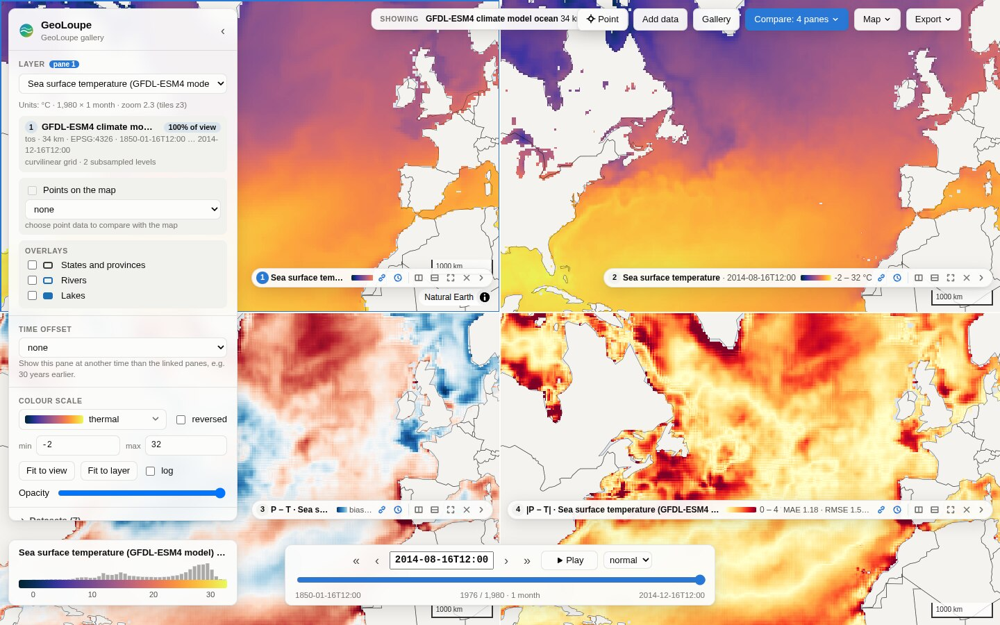

# Error maps

An **error pane** shows the error of one layer, **P** (the compared data, e.g. a model or a
prediction), against another, **T** (the reference, e.g. observations or a reanalysis), at every
point of the map. Typical layout: pane 1 = T, pane 2 = P, pane 3 = P − T, pane 4 = |P − T|.



## Making an error pane

* **From two panes:** *Compare → Error map*, choose P's pane, T's pane and the error, then *Add error
  pane*. The new pane **follows** both panes: change their layer, time or level and the error map
  follows. Closing a followed pane keeps its layer in the error pane.
* **In one pane:** with a single pane, *Compare → Show the error map here* compares the pane's layer
  (P) with a layer you choose (T).
* **In a link or a featured view:** see [configuration](configuration.md) (`views:` → `panes:` → `error:`).

The side panel of an active error pane sets the error definition, its parameters or a custom
formula, which panes P and T follow (or fixed layers), swaps P and T, or goes back to P alone.

## Error definitions

| Group | Name | Formula | Units |
|---|---|---|---|
| Basic | Error (bias) | P − T | of T |
| | Absolute error | \|P − T\| | of T |
| | Squared error | (P − T)² | of T, squared |
| Relative | Relative error | 100 (P − T) / T | % |
| | Absolute relative error | 100 \|P − T\| / \|T\| | % |
| | Symmetric relative error | 200 (P − T) / (\|P\| + \|T\|) | % |
| | Ratio | P / T | – |
| | Log ratio | ln(P / T) | – |
| Normalised | Normalised error | (P − T) / s | – |
| Events | Event agreement | hit (P ≥ h, T ≥ h), miss, false alarm, correct no event | classes |
| | Sign agreement | P − c and T − c on the same side, or not | classes |
| Your own | Custom formula | any formula of P and T | as you set |

Parameters: relative errors and ratios have **eps** (no value where |T| ≤ eps, e.g. 0.1 mm/day for
precipitation); the normalised error has **s** (a number, or *σ of T in view*); events have the
threshold **h**; sign agreement the value **c**.

**Units.** P is converted into T's units first when they differ in a known way: K, °C and °F;
m, cm, mm and kg m⁻²; precipitation rates (mm/day, m/day, mm/h, kg m⁻² s⁻¹); speeds; pressures;
fractions and %. Other differing units are compared as they are, with a warning.

**Missing data stays missing:** where P or T has no value, the error has none.

### Custom formulas

A small, safe formula language (no Python is evaluated), the same in the browser and on the server:

* `P`, `T`, numbers, `nan`, `pi`
* `+ - * /`, `^` or `**` (power), comparisons `< <= > >= == !=`, `and`, `or`, `not`
* `abs sqrt log log10 exp sign isnan`, `min(a, b, …)`, `max(a, b, …)`, `where(cond, a, b)`

Examples: `abs(P - T) / (abs(T) + 1)`, `where(T > 0, P / T, nan)`, `abs(P - T) > 2` (where the error
exceeds 2), `(P > 1) - (T > 1)` (+1 where only P has an event, −1 where only T has one).

A comparison or `where` with a missing input gives no value; results that are not finite (division
by zero, `log(0)`) give no value.

## Exact from the native cells

A pixel of a zoomed-out map covers many native cells. The error of the averages
(|mean P − mean T|) is not the average error (mean |P − T|): errors of opposite sign cancel inside
the pixel. GeoLoupe therefore computes error maps from the **native cells**:

1. The browser first draws a **preview** from P's and T's display tiles (instant).
2. The server then sends **exact tiles**: each screen pixel is split into sub-pixels no larger than
   the finest native cell of P and T; P and T are read at their native level, the error is computed
   per sub-pixel and averaged to the pixel (class maps: the most frequent class).

The status badge says *native cells* (exact) or *coarser grid*. Exactness has limits: at most
`error_max_subpixels` sub-pixels per tile side (default 2048, i.e. 8 × 8 per pixel) and
`error_read_cells` cells read per source (default 16 million). For 1 km data, tiles are exact from
zoom 5; a whole continent or the globe needs a precomputed error map (below).

### Statistics of the view

The pane box and the colour bar show statistics over the native cells in view:

* bias: **bias, MAE, RMSE** (mean of P − T, mean of |P − T|, root mean square)
* absolute error: MAE and RMSE; squared error: MSE and RMSE
* other definitions: mean and mean |·|
* event agreement: **POD** (hits / observed events), **FAR** (false alarms / forecast events),
  **CSI** (hits / (hits + misses + false alarms)) and the **frequency bias** (forecast / observed
  events)
* sign agreement: the share of cells on the same side

### At a point

With *Point* (key `i`), a click shows P, T and the error from their native values, and the error
**over time** at that point with its mean, mean |·| and RMS. When T has much finer time steps than P
(hourly against monthly), the window is cut around the current time.

## Precomputed error maps

For views wider than the read budget (a global 1 km field seen whole), compute the error once:

```bash
geoloupe errors build config.yaml model:tas obs:tas errors/model-vs-obs.zarr \
    --metric abs --start 2020-01-01 --end 2020-12-31
```

The error is computed per native cell of the finer of the two grids (that layer must be one dataset
variable on 1-D x/y coordinates; the other is sampled at its cell centres) and time step, and
written as Zarr with block-mean overviews (the most frequent class for event maps). Add the printed
lines to the configuration:

```yaml
datasets:
  model-vs-obs:
    path: errors/model-vs-obs.zarr
    overviews: errors/model-vs-obs.overviews.zarr
```

An error pane asking for the same P, T, definition, parameters and levels (and the same time for P
and T) is then drawn from this store: exact at every zoom. Options: `--formula`, `--params eps:0.1`,
`--units`, `--p-dims plev:500`, `--t-dims …`, `--no-overviews`, `--overwrite`.

## HTTP API

* `GET /api/error/tiles/{z}/{x}/{y}.bin?p=&t=&pt=&tt=&pd=&td=&metric=&formula=&params=&units=`:
  an exact error tile (the data-tile format of [data-tiles.md](data-tiles.md), no source map);
  headers `X-GeoLoupe-Exact`, `X-GeoLoupe-Subpixels`, `X-GeoLoupe-Cell-M`, and
  `X-GeoLoupe-Precomputed` when drawn from a precomputed store.
* `GET /api/error/stats?…&bbox=w,s,e,n&z=`: count, mean, mean_abs, rms, min, max, exact, cell_m;
  for class maps the cells per class, and POD, FAR, CSI and frequency bias for event maps.
* `GET /api/error/preview.png?…&center=lon,lat&zoom=&width=&height=`: a picture of the error map.

`p` and `t` are layer ids, `pt`/`tt` their times, `pd`/`td` their extra dimensions (`plev:500`),
`params` the parameters (`eps:0.1,h:1`).
